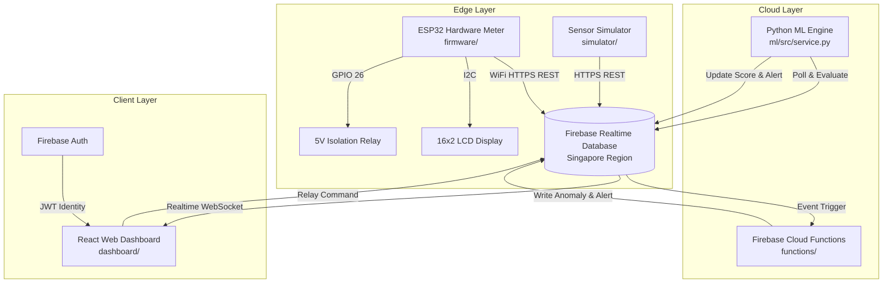

# System Architecture & Component Design
**Project:** Smart Electricity Theft Detection  
**Document:** `docs/architecture.md`  
**Status:** Complete Specification

---

## 1. End-to-End Data Pipeline

1. **Acquisition:**
   - Physical: ESP32 samples AC voltage (ZMPT101B on GPIO 34) and AC current (ACS712 on GPIO 35) over multiple 50Hz cycles (40ms integration window) to compute real RMS values.
   - Simulation: Software simulator (`simulator/main.py`) generates circadian domestic load curves, meter bypass, line tapping, or off-peak surges.
2. **Cloud Telemetry Ingestion:**
   - Client pushes validated payload to `https://electricity-theft-detect-cae09-default-rtdb.asia-southeast1.firebasedatabase.app/latest_readings/{deviceId}.json` and appends to `/readings/{deviceId}.json`.
3. **AI / ML Anomaly Scoring:**
   - The ML scoring engine (`ml/src/service.py`) and Cloud Functions evaluate the telemetry against the trained Isolation Forest model (`ml/models/`) and physical domain rules.
   - Outputs a normalized 0–100 Anomaly Risk Score.
4. **Alert & Cooldown Processing:**
   - If anomaly risk exceeds 65.0 or status is `TAMPERED`/`FAULT`, a structured alert is dispatched to `/alerts/{deviceId}` with a 2-minute deduplication cooldown window.
5. **Operator Dashboard Visualization:**
   - Authenticated operators view live gauges, interactive SVG history charts, fleet device managers, and alert action feeds.
   - Remote relay commands are dispatched to `/control/{deviceId}` with mandatory confirmation.
6. **Actuation:**
   - The ESP32 polls `/control/{deviceId}` and physically trips or restores the supply relay.
